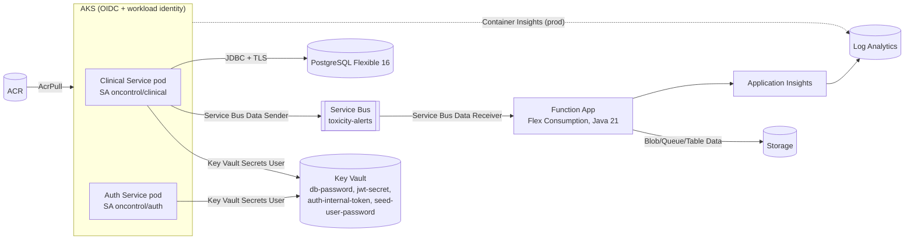

# Infraestructura como código (Bicep)

## Estructura

```
bicep/
├── main.bicep                 # Orquestación (scope: resource group)
├── bicepconfig.json           # Linter: reglas de seguridad como error
├── modules/
│   ├── monitoring.bicep       # Log Analytics + Application Insights (con tope diario)
│   ├── acr.bicep              # Container Registry (sin admin user) + AcrPull
│   ├── aks.bicep              # AKS: OIDC issuer, workload identity, CSI de Key Vault
│   ├── workload-identity.bicep# Identidad (clinical, auth) federada al service account en cada namespace
│   ├── postgres.bicep         # PostgreSQL Flexible 16 + base OnControlSem + bases adicionales
│   ├── keyvault.bicep         # Key Vault RBAC + secretos db-password / jwt-secret / auth-internal-token / seed-user-password
│   ├── servicebus.bicep       # Namespace + cola toxicity-alerts (SAS deshabilitado)
│   └── functionapp.bicep      # Function App Flex Consumption (Java 21) + Storage
└── params/
    ├── dev.bicepparam
    └── prod.bicepparam
```

## Arquitectura y permisos (todo por identidad, sin connection strings con secretos)



## Ambientes

Región: **brazilsouth** (la toma de su resource group). Ver por qué en la sección siguiente.

| Parámetro | dev | prod |
|---|---|---|
| AKS | Free, 2 × Standard_D2s_v4, disco SO 32 GiB, Cilium | Standard (SLA), 2 × Standard_D2s_v4, disco 64 GiB, Container Insights |
| PostgreSQL | B1ms, 32 GB, backup 7 días | B2s, 64 GB, backup 14 días |
| ACR | Basic | Standard |
| Key Vault | sin purge protection | purge protection |
| Logs | 30 días, tope 1 GB/día | 90 días, tope 5 GB/día |

`deployAks=false` despliega solo datos, mensajería, secretos y la Function (sin AKS ni ACR).

### Cambios para el auth-service en AKS

- **Cilium** (`networkDataplane` y `networkPolicy` = `cilium`): se fija al crear el cluster y es **irreversible**
  (volver al dataplane por defecto exige recrear el cluster). Sin NetworkPolicies aplicadas es inocuo.
- **2 nodos** con `upgradeSettings {maxSurge: 0, maxUnavailable: 1}`: la cuota DSv4 (4 vCPU) no admite un nodo extra
  durante upgrades, se actualiza de a un nodo.
- **Bases de datos adicionales** en el mismo servidor PostgreSQL (`additionalDatabases`, gratis): `oncontrol_auth`,
  `oncontrol_prod`, `oncontrol_auth_prod`. Mismo login administrador para todas (riesgo documentado; roles por servicio
  quedan para después de TB4).
- **Secretos nuevos** escritos por Bicep en Key Vault desde secretos del environment de GitHub (sin `az keyvault secret set`):
  `AUTH_INTERNAL_TOKEN` (>= 32 bytes) -> `auth-internal-token`; `SEED_USER_PASSWORD` (16-72 bytes, límite de entrada de
  bcrypt) -> `seed-user-password`. Los params fallan al compilar si faltan.
- **Identidad `id-<prefijo>-auth`** (service account `auth`) con credencial federada por namespace (`appNamespaces`:
  `oncontrol`, `oncontrol-prod`; escritura serializada con `@batchSize(1)` porque ARM rechaza escrituras concurrentes sobre
  una misma identidad) y lectura de Key Vault. Nuevos outputs: `authWorkloadIdentityClientId`, `postgresFqdn` (ya existente).
- `iac.yml` crea los namespaces `oncontrol` y `oncontrol-prod` con Pod Security `restricted`.

### Cuota y costo con 2 nodos (dev)

- Cuota DSv4 = 4 vCPU = exactamente 2 × D2s_v4: no hay margen para un tercer nodo ni para surge.
- Costo con todo encendido: **~USD 0,38 por hora** (2 nodos USD 0,306 + PostgreSQL, LB, IP). Apagar al terminar
  (`az aks stop`, `az postgres flexible-server stop`).

## Restricciones de la suscripción Azure for Students (verificadas el 2026-11-17)

Se verificaron **antes** del primer despliegue: el what-if no detecta cuotas ni SKUs no habilitados,
y un despliegue fallido a mitad de camino también consume crédito.

| Verificación | Resultado | Consecuencia |
|---|---|---|
| Política *Allowed resource deployment regions* | Solo `canadacentral`, `chilecentral`, `brazilsouth`, `eastus`, `southcentralus` | Universo de regiones |
| PostgreSQL Flexible (`az postgres flexible-server list-skus`) | `Provisioning is restricted` en `eastus` y `southcentralus` | Descartadas |
| Flex Consumption (`az functionapp list-flexconsumption-locations`) | No disponible en `chilecentral` | Descartada |
| Tamaños para AKS sin restricción **y** con cuota (`az aks list-vm-skus` × `az vm list-usage`) | `canadacentral`: solo Bpsv2 (**ARM64**, imágenes actuales amd64). `brazilsouth`: D2s_v4, D2_v4, D2ds_v4, E2_v4… (DSv4 = 4 vCPU) | **brazilsouth**, nodo `Standard_D2s_v4` (x86, 2 vCPU, 8 GB) |
| Cuota DASv5 / DASv4 | DASv5 = 0; `Standard_D2as_v4` figura `NotAvailableForSubscription` | Se descartaron los tamaños `as` |

`prod` usa 2 × D2s_v4 = 4 vCPU, toda la cuota DSv4: no puede convivir con dev encendido.
Ventaja colateral: brazilsouth es la región permitida más cercana a Perú (menor latencia para los usuarios).

## Costo de dev (Azure Retail Prices API, brazilsouth, 2026-11-17)

| Recurso | Precio | 24/7 (730 h) |
|---|---|---|
| Nodo AKS Standard_D2s_v4 | USD 0,153/h | 111,69 |
| PostgreSQL B1ms | USD 0,035/h | 25,55 |
| Disco SO del nodo (P4, 32 GiB) | USD 9,12/mes | 9,12 |
| IP pública Standard | USD 0,005/h | 3,65 |
| ACR Basic | USD 0,1666/día | 5,00 |
| Load Balancer Standard (AKS) | ≈ USD 0,025/h *(referencial, no devuelto por la API)* | ≈ 18,25 |
| Almacenamiento PostgreSQL 32 GB | ≈ USD 0,115/GB-mes *(referencial)* | ≈ 3,68 |
| Service Bus Basic | USD 0,05 por millón de operaciones | ≈ 0 |
| Function App Flex Consumption | dentro de la cuota gratuita | ≈ 0 |
| Key Vault, Storage, Log Analytics (bajo volumen) | — | < 1 |
| **Total** | | **≈ USD 177/mes** |

**Encendido 24/7 dev supera ampliamente el crédito de Azure for Students (USD 100).** Uso obligatorio:

- Encender solo para pruebas y demos: **≈ USD 0,24 por hora** con 1 nodo (**≈ USD 0,38** con los 2 nodos de dev actuales; una demo de 4 h ≈ USD 1,5).
- Apagar al terminar (se conservan configuración y datos):
  ```bash
  az aks stop -g rg-oncontrol3d-dev -n aks-oc3d-dev
  az postgres flexible-server stop -g rg-oncontrol3d-dev -n <psql-oc3d-dev-xxxxxx>
  ```
  Con AKS y PostgreSQL detenidos quedan los costos fijos (Load Balancer, IP, ACR y almacenamiento), ≈ USD 1/día.
  PostgreSQL se reinicia solo a los 7 días de estar detenido.
- Para no pagar nada: `az group delete -n rg-oncontrol3d-dev` y redesplegar con el pipeline.
  La identidad del pipeline vive en `rg-oncontrol3d-cicd`, así que no se pierde al borrar el grupo de dev.

prod se mantiene definido y validado (build, lint, what-if) pero **no se despliega** con el crédito de estudiante.

## Decisiones

| Decisión | Alternativa descartada | Motivo |
|---|---|---|
| Bicep modular | Terraform | Nativo de Azure, sin backend de estado que administrar; what-if integrado |
| Flex Consumption para la Function | Consumption (Y1) Linux | Microsoft retira el plan Consumption de Linux; Flex soporta identidad para storage y deployment |
| Identidades y RBAC en todo | Connection strings / SAS / claves | Nada que rotar ni filtrar; Service Bus con `disableLocalAuth` y Storage con `allowSharedKeyAccess: false` |
| Secretos vía `readEnvironmentVariable` | Valores en `.bicepparam` | Nunca están en el repo; si faltan, los params no compilan (`@minLength`) |
| PostgreSQL con acceso público + regla "Azure services" + TLS | VNet privada | La red privada exige VNet, subred delegada y DNS privado (más costo y complejidad). Es el siguiente paso para prod |
| Postgres administrado | Postgres dentro de AKS (demo anterior) | Backups automáticos, parches y sin volumen persistente que cuidar |
