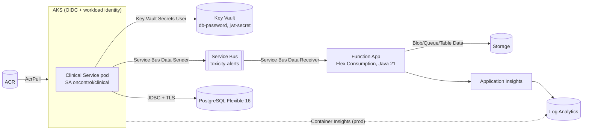

# Infraestructura como código (Bicep)

## Estructura

```
bicep/
├── main.bicep                 # Orquestación (scope: resource group)
├── bicepconfig.json           # Linter: reglas de seguridad como error
├── modules/
│   ├── monitoring.bicep       # Log Analytics + Application Insights (con tope diario)
│   ├── acr.bicep              # Container Registry (sin admin user) + AcrPull
│   ├── aks.bicep              # AKS: OIDC issuer, workload identity, CSI de Key Vault
│   ├── workload-identity.bicep# Identidad del Clinical Service federada al service account
│   ├── postgres.bicep         # PostgreSQL Flexible 16 + base OnControlSem
│   ├── keyvault.bicep         # Key Vault RBAC + secretos db-password / jwt-secret
│   ├── servicebus.bicep       # Namespace + cola toxicity-alerts (SAS deshabilitado)
│   └── functionapp.bicep      # Function App Flex Consumption (Java 21) + Storage
└── params/
    ├── dev.bicepparam
    └── prod.bicepparam
```

## Arquitectura y permisos (todo por identidad, sin connection strings con secretos)



## Ambientes

| Parámetro | dev | prod |
|---|---|---|
| AKS | Free, 1 × D2as_v5 | Standard (SLA), 2 × D2as_v5, Container Insights |
| PostgreSQL | B1ms, 32 GB, backup 7 días | B2s, 64 GB, backup 14 días |
| ACR | Basic | Standard |
| Key Vault | sin purge protection | purge protection |
| Logs | 30 días, tope 1 GB/día | 90 días, tope 5 GB/día |

`deployAks=false` despliega solo datos, mensajería, secretos y la Function (sin AKS ni ACR).

## Costo de dev (precios Azure Retail Prices API, eastus, 2026-11-17)

| Recurso | Precio | 24/7 (730 h) |
|---|---|---|
| Nodo AKS Standard_D2as_v5 | USD 0,086/h | 62,78 |
| Disco SO del nodo (P6, 64 GiB) | USD 10,21/mes | 10,21 |
| Load Balancer Standard (AKS) | ≈ USD 0,025/h *(referencial, no devuelto por la API)* | ≈ 18,25 |
| IP pública Standard | USD 0,005/h | 3,65 |
| PostgreSQL B1ms | USD 0,017/h | 12,41 |
| Almacenamiento PostgreSQL 32 GB | *(referencial ≈ USD 0,115/GB-mes)* | ≈ 3,68 |
| ACR Basic | USD 0,1666/día | 5,00 |
| Service Bus Basic | USD 0,05 por millón de operaciones | ≈ 0 |
| Function App Flex Consumption | dentro de la cuota gratuita | ≈ 0 |
| Key Vault, Storage, Log Analytics (bajo volumen) | — | < 1 |
| **Total** | | **≈ USD 117/mes** |

**Encendido 24/7 dev supera el crédito de Azure for Students (USD 100).** Uso recomendado:

- Encender solo para pruebas y demos: **≈ USD 0,15 por hora** con todo encendido.
- Apagar al terminar (se conservan configuración y datos):
  ```bash
  az aks stop -g rg-oncontrol3d-dev -n aks-oc3d-dev
  az postgres flexible-server stop -g rg-oncontrol3d-dev -n <psql-oc3d-dev-xxxxxx>
  ```
  Con AKS y PostgreSQL detenidos quedan los costos fijos (Load Balancer, IP, ACR y almacenamiento), ≈ USD 1/día.
  PostgreSQL se reinicia solo a los 7 días de estar detenido.
- Para no pagar nada: `az group delete -n rg-oncontrol3d-dev` y redesplegar con el pipeline.

prod se mantiene definido y validado (build, lint, what-if) pero **no se despliega** con el crédito de estudiante.

## Decisiones

| Decisión | Alternativa descartada | Motivo |
|---|---|---|
| Bicep modular | Terraform | Nativo de Azure, sin backend de estado que administrar; what-if integrado |
| Flex Consumption para la Function | Consumption (Y1) Linux | Microsoft retira el plan Consumption de Linux; Flex soporta identidad para storage y deployment |
| Identidades y RBAC en todo | Connection strings / SAS / claves | Nada que rotar ni filtrar; Service Bus con `disableLocalAuth` y Storage con `allowSharedKeyAccess: false` |
| Secretos vía `readEnvironmentVariable` | Valores en `.bicepparam` | Nunca están en el repo; si faltan, los params no compilan (`@minLength`) |
| PostgreSQL con acceso público + regla "Azure services" + TLS | VNet privada | La red privada exige VNet, subred delegada y DNS privado (más costo y complejidad). Es el siguiente paso para prod |
| Postgres administrado | Postgres dentro de AKS (demo anterior) | Backups automáticos, parches y sin volumen persistente que cuidar |
